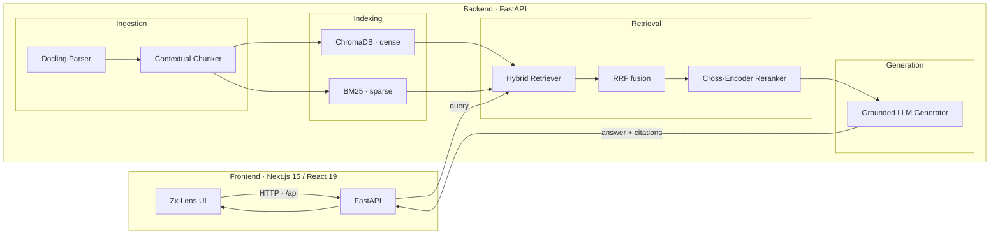

# Zx Lens 🔭

**Upload PDFs. Ask in plain English. Get answers with proof.**

Zx Lens is an end-to-end **Retrieval-Augmented Generation (RAG)** system that turns a
pile of documents into a question-answering engine — every answer grounded in the
source, with clickable citations you can verify.

> This repo is the full stack: a production-grade FastAPI RAG engine + a polished
> Next.js UI. Built to be domain-agnostic — works on contracts, research papers,
> manuals, whatever you throw at it.


---

## Highlights ⭐

- 🧠 **Hybrid retrieval** — dense embeddings **⊕** BM25 lexical, fused with
  **Reciprocal Rank Fusion (RRF)** and refined by a **cross-encoder reranker**.
- 📚 **Zero-hallucination generation** — structured output, inline `[n]` citations,
  and an explicit "unanswerable" path instead of guessing.
- 🔌 **Provider-agnostic LLM layer** — Inception Mercury‑3 by default, with Gemini,
  Groq, and OpenAI as drop-in fallbacks.

---

## Architecture 🏗️

Two services, one clean data flow: **ingest → index → retrieve → generate**.



### The retrieval pipeline (with real numbers)

| Stage | What happens | Params |
| :--- | :--- | :--- |
| **1 · Dense search** | Embed the query, find semantically close chunks | top‑K = 25 |
| **2 · Sparse search** | Match exact lexical terms via BM25 | top‑K = 25 |
| **3 · Fusion** | Merge both rankings with RRF, no weight tuning | k = 60 |
| **4 · Rerank** | Cross-encoder scores (query, chunk) pairs jointly | top‑N = 15 |
| **5 · Generate** | Feed top passages to the LLM with grounding schema | top‑K = 5 |

> **Why two retrievers?** Dense embeddings nail *meaning*; BM25 nails *exact
> terms* (clause numbers, dollar figures, proper nouns). Neither is enough alone —
> fusing them is the sweet spot. RRF is chosen over weighted score blends because it
> needs **zero hyperparameter tuning** and is robust to score-scale mismatches.

---

## Key design decisions 🎯

These are the choices that matter, and *why* they were made:

| Decision | Why |
| :--- | :--- |
| **Contextual chunking** | Naive fixed-size chunks break semantic boundaries. Chunks carry section breadcrumbs so the model knows *where* a claim lives. |
| **Dual-index atomic sync** | The ChromaDB and BM25 stores are written together via an `IndexManager`, guaranteeing aligned `chunk_id`s — no orphaned vectors. |
| **Structured grounded generation** | The LLM must emit a strict JSON schema: claim → `[n]` marker → `chunk_id` → **verbatim quote**. If evidence is insufficient it must set `unanswerable_reason` — hallucination is structurally prevented, not just discouraged. |
| **Cross-encoder reranking** | A bi-encoder (used for retrieval) can't model fine-grained relevance. The cross-encoder attends over the query and chunk together — much better precision before the LLM sees context. |
| **Provider-agnostic LLM layer** | Inception → Gemini → Groq → OpenAI, auto-detected from env keys. One interface, many backends; lets you swap models without touching pipeline code. |

---

## Tech stack 🧰

| Layer | Technology |
| :--- | :--- |
| **Frontend** | Next.js 15 · React 19 · TypeScript · Tailwind CSS · Framer Motion |
| **API** | FastAPI · Pydantic v2 · Uvicorn |
| **Parsing** | Docling (layout-aware: text / tables / headers) |
| **Dense index** | ChromaDB · `BAAI/bge-small-en-v1.5` embeddings |
| **Sparse index** | BM25 (`rank-bm25`) |
| **Reranker** | cross-encoder · `ms-marco-MiniLM-L-6-v2` |
| **LLMs** | Inception Mercury‑3 (default) · Gemini · Groq · OpenAI |
| **Testing** | pytest |
| **Ops** | Python 3.12 · `structlog` · `rich` |

---

## Project layout 🗂️

```
FULL_PROJECT
├── backend/                  # FastAPI RAG engine
│   ├── src/
│   │   ├── api/              #   app + documents/query routers
│   │   ├── ingestion/        #   Docling parser + contextual chunker
│   │   ├── indexing/         #   ChromaDB + BM25 stores, atomic IndexManager
│   │   ├── retrieval/        #   hybrid retriever, RRF, cross-encoder reranker
│   │   ├── generation/       #   grounded structured generation + prompts
│   │   ├── schemas/          #   Pydantic contracts
│   │   └── config.py         #   env-driven settings (Pydantic v2)
│   ├── data/                 # raw docs, indices, processed
│   └── tests/                # pytest suite (chunker, stores, RRF, gen, API)
└── frontend/                 # Next.js + Tailwind UI
    └── src/
        ├── app/              # pages / layout
        └── components/       # Ask, Answer, Citations, Documents, Pipeline visualizer
```

---

## Getting started ⚡

### Backend

```bash
cd backend
python3.12 -m venv .venv && source .venv/bin/activate
pip install -r requirements.txt
cp ../.env.example ../backend/.env   # add at least one LLM API key
```

Seed the sample contract corpus (optional but recommended for a quick demo):

```bash
python -m backend.data.ingest_sample
```

Run the API:

```bash
uvicorn backend.src.api.main:app --reload --port 8000
```

Health check → `curl http://localhost:8000/health`

### Frontend

```bash
cd frontend
npm install
npm run dev
```

Open **http://localhost:3000**. The UI talks to `http://localhost:8000/api` by
default; override with `NEXT_PUBLIC_API_URL`.

---

## API surface 🌐

| Method | Endpoint | Purpose |
| :--- | :--- | :--- |
| `POST` | `/api/documents/upload` | Upload + index a PDF |
| `GET` | `/api/documents/list` | List indexed documents |
| `GET` | `/api/documents/stats` | Index storage counts |
| `GET` | `/api/documents/{chunk_id}` | Inspect a single chunk |
| `POST` | `/api/query/ask` | Grounded Q&A with citations |
| `POST` | `/api/query/search` | Hybrid retrieval only (no generation) |

---

Run the suite:

```bash
cd backend && source .venv/bin/activate && pytest -q
```

---

*Questions, ideas, or want to collaborate?
Open an issue or reach out.* 👋
